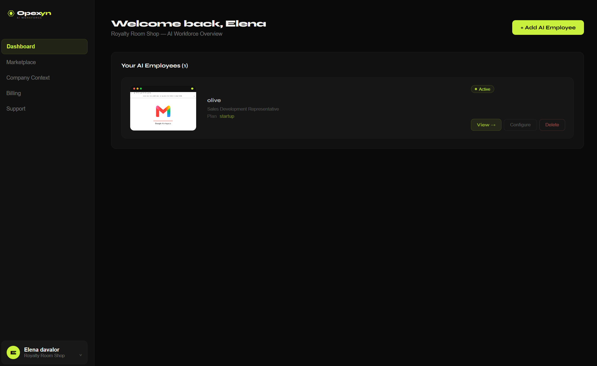
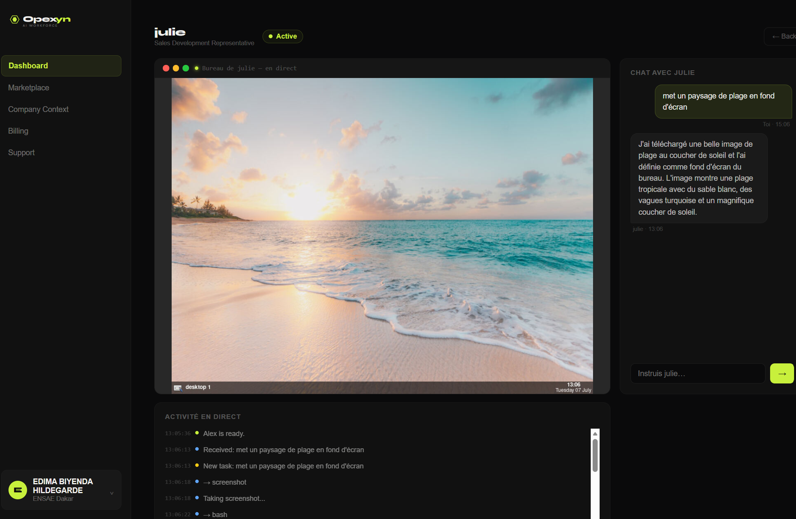
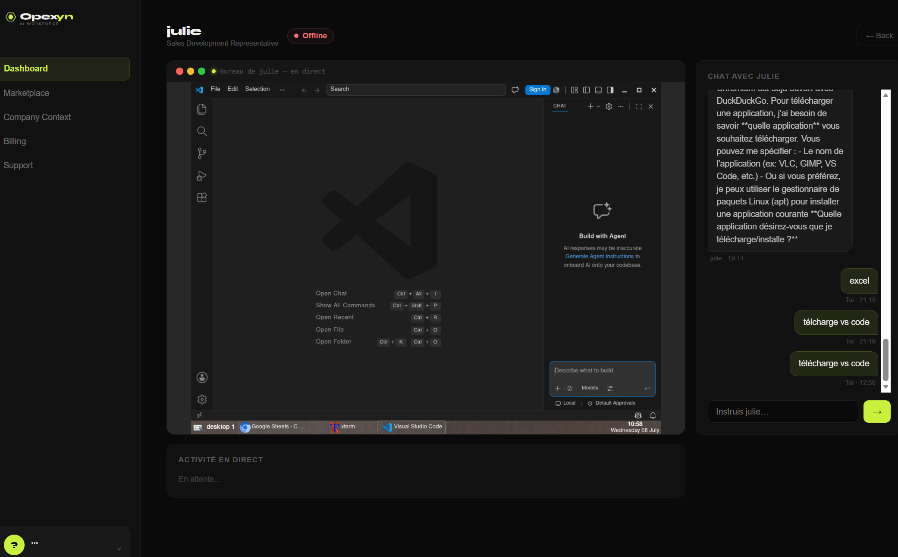
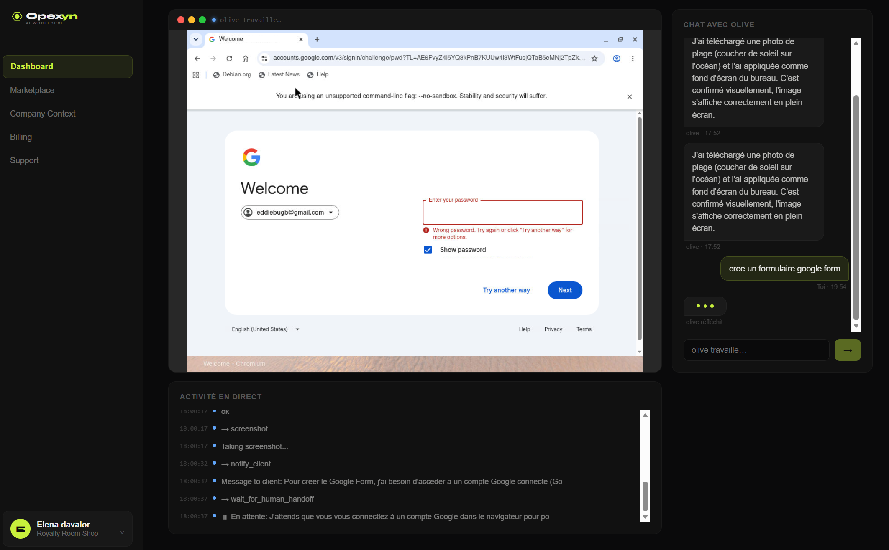
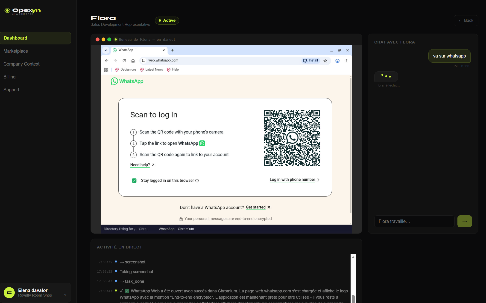

# Opexyn

**Specialized AI employees that perform real business work.**

Opexyn is an AI Workforce Platform: instead of chatbots that answer questions, it deploys autonomous agents that execute tasks end to end (prospecting, CRM updates, social media management), follow a defined objective and report their progress.

> Status: working MVP, not yet publicly deployed.

## Demo

<p align="center">
  
  
  
  
  
</p>

## How it works

```
User objective ──► Agent Runtime ──► Skill bundle ──► Isolated Docker container
                       │               (RAG + atomic      (Playwright browser
                       │                actions)            automation + Claude)
                       ▼
                Progress reports & action log
```

- **Agent Runtime:** shared core that plans, executes and reports. Roles plug in as skill bundles.
- **Skill bundles:** a RAG knowledge base plus deterministic atomic actions. The LLM decides what to do; critical steps stay predictable.
- **Isolated execution:** each agent works in its own Docker container with a Playwright-driven browser.
- **Two modes:** predefined roles (sales, customer support, ops) and a free-form agent mode.
- **Safety:** a progressive autonomy model with permanent hard limits on what agents may do.

## Cost engineering

- DOM text extraction instead of screenshot-based vision
- A lightweight Haiku classifier layer to route steps
- Capped context windows


## Stack

React · Node.js · Docker · Playwright · Claude API · RAG

## Author

Hildegarde Edima Biyenda, statistics and data science engineering student (ENSAE Dakar).
[LinkedIn](www.linkedin.com/in/hilda-biyenda-993821258) · [Email](edimabbiyenda@yahoo.com)
